# wiredown

Mermaid for UI screens. Write your app's screens as markdown and get clickable wireframes and a looping walkthrough. Made for AI to write.



The walkthrough above is one SVG file made by `wiredown animate` from [docs/hero.wiredown](docs/hero.wiredown).

- **Playground:** [manup-dev.github.io/wiredown](https://manup-dev.github.io/wiredown/). Type on the left and the screens draw on the right. Press Play for the walkthrough, then download it as SVG or GIF.
- **With your AI:** `claude mcp add wiredown -- npx -y wiredown mcp` gives Claude Code the language, lint, links and drawing as tools (setup for other tools in [Use with AI](#use-with-ai)). Or press "Copy prompt for your AI" in the playground and paste it into any chat.
- **Command line:** `npx wiredown animate flow.wiredown` writes the flow as `flow.svg`.

## The language


```wiredown
@device phone
@title "Sign in"
screen login "Sign in"
  stack pad=24 gap=16
    h1 "Welcome back" align=center
    input "Email" placeholder="you@company.com" #email
    input "Password" type=password #password
    row justify=between
      checkbox "Remember me" checked
      link "Forgot password?" -> reset
    button "Sign in" primary w=fill #submit note="Disabled until both fields are filled"

variant login-error of login "Wrong password"
  #password error="That password is not right"

screen reset "Reset password"
  navbar "Reset password" back -> login
  stack pad=24 gap=16
    input "Email" #reset-email
    button "Send link" primary w=fill
```

One block is one flow: screens, variants of a screen, the links between them and numbered notes. The picture above is the `login` screen, made by `wiredown render`. The same block also draws the `login-error` variant beside it and the `reset` screen. Headers pick the device (`@device phone`, or `@device phone fit` to end each screen at its content) and the look (`@look wire` or `@look clean`). The whole language is in [docs/language.md](docs/language.md).

This page describes version 0.2.0 (see [CHANGELOG.md](CHANGELOG.md)). wiredown was first called wiremark; fences tagged `wiremark` (or `screens`) still draw.

## Try it

Playground: [manup-dev.github.io/wiredown](https://manup-dev.github.io/wiredown/). Type on the left and the screens draw on the right. Click any drawn element to find its line, fold screens, zoom, try the example flows, and share a link (the text travels in the link; nothing is sent to a server). Play opens the walkthrough of the flow, with Download SVG, Download GIF, a README snippet and a link that opens straight into Play (it ends in `!play`).

## Why

- **The text is the source of truth.** A mock is a few lines in your markdown, so it diffs, reviews, merges and keeps its history like the rest of the document, in git or anywhere else.
- **Flows, not single screens.** Screens, variants (a screen with a few things changed), links between screens, notes on any element, and a prototype view (`view=prototype`) that shows one screen at a time and follows the links, with CSS only.
- **Safe anywhere.** The output is static SVG: no script, no URLs, no images or fonts from the author's text. Nothing in it can run or load, so it is safe to put in email, in EPUB and behind an HTML sanitizer.
- **Made for AI.** `AI_CONTRACT` is the whole language as one text for a model; `wiredown lint` gives line-numbered problems a model can fix; the same text always draws the same picture.

## Use with AI

### The MCP server

`wiredown mcp` runs a Model Context Protocol server on stdio with five tools:

| Tool | What it does |
| --- | --- |
| `get_wiredown_grammar` | Returns the whole language as one text (the same text as `wiredown contract`). |
| `lint_wiredown` | Checks a block and lists its problems. |
| `wiredown_link` | Returns a playground link that draws the block. The text travels in the link. |
| `render_wiredown` | Returns the drawing as HTML, or with `outDir` writes one SVG per screen. |
| `animate_wiredown` | Writes the flow as one animated SVG file. |

Claude Code: `claude mcp add wiredown -- npx -y wiredown mcp`. The lines for Claude Desktop, Cursor and VS Code are in [integrations/agents](https://github.com/manup-dev/wiredown/blob/main/integrations/agents/README.md).

The two writing tools write only `.svg` files inside the folder the server runs in, or the one given with `--root <folder>`. They never replace a file wiredown did not make: each file they write starts with `<!-- made by wiredown -->`, and an existing file without that line is kept. The SVG files from `wiredown render` and `wiredown animate` start with the same line, so the tools may write them again. Add `--icons <package>` to use an icon pack.

### Files for AI coding tools

- A Claude skill: [SKILL.md](https://github.com/manup-dev/wiredown/blob/main/integrations/agents/SKILL.md), for `~/.claude/skills/wiredown/`.
- A Cursor rule: [wiredown.mdc](https://github.com/manup-dev/wiredown/blob/main/integrations/agents/cursor/wiredown.mdc), for `.cursor/rules/`.
- A section for an `AGENTS.md` file: [AGENTS.md](https://github.com/manup-dev/wiredown/blob/main/integrations/agents/AGENTS.md).

### By hand, in any chat

1. Give the model the language: `npx wiredown contract` prints it (about 6,300 characters), and the playground's "Copy prompt for your AI" copies it. Paste it into the system prompt or the start of the chat.
2. Ask for a fenced `wiredown` block, for example:

   > Using the wiredown language above, write one fenced `wiredown` block for a two-step sign-up on a phone: an email and password screen, then a "check your email" screen with a resend link. Link the screens with `->`. Reply with the block only.

3. Save the answer in a markdown file and check it: `npx wiredown lint spec.md`. Each problem is one line, `file:line:column severity code message`, and the command exits 1 when there is an error.
4. If there are problems, paste the lint output back to the model and ask it to fix the block. Then draw it: `npx wiredown render spec.md --out screens/` (one SVG per screen, or `--format html` for one page), `npx wiredown animate spec.md` for the walkthrough, or `npx wiredown link spec.md` for a playground link.

## Icons

`icon "bell"` draws an icon, and buttons, links, list items, tabs and badges take `icon=bell`. 43 icons are built in:

`apple bell calendar card check check-circle chevron-down chevron-left chevron-right circle-alert circle-help clock copy download edit external-link eye-off file filter github google heart home image lock log-in log-out mail menu message-circle more plus search settings shopping-cart star trash trash-2 upload user users x x-circle`

Aliases: `gear` and `cog` (settings), `delete` (trash-2), `close` (x), `profile` (user), `cart` (shopping-cart), `notifications` (bell), `chat` (message-circle), `help` (circle-help), `warning` (circle-alert), `error` (x-circle), `success` (check-circle), `logout` (log-out), `login` (log-in). An unknown name draws a placeholder ring and lints as `unknown_icon`.

Bigger sets are separate packages, each made from a pinned upstream release:

| Package | Icons | Licence | Made from |
| --- | ---: | --- | --- |
| [`wiredown-icons-lucide`](integrations/icons-lucide/README.md) | 2,356 | ISC (the icons), MIT (the package) | `lucide-static` 1.72.0 |
| [`wiredown-icons-tabler`](integrations/icons-tabler/README.md) | 5,231 | MIT | `@tabler/icons` 3.51.0, outline |
| [`wiredown-icons-heroicons`](integrations/icons-heroicons/README.md) | 324 | MIT | `heroicons` 2.2.0, 24 px outline |

How to load one is under [Icon packs](#icon-packs).

## Images

An image is a placeholder that says what it stands for:

```
image "Revenue by week" type=chart ratio=16:9
```

`type` is `photo`, `chart`, `map`, `video`, `illustration`, `logo` or `avatar` and picks the glyph in the middle. `ratio` is `16:9`, `4:3`, `3:2`, `1:1`, `9:16` or `21:9` and sets the height from the width, unless `h=` is given. There is no way to put a picture's data or address in the text: a base64 image would be thousands of tokens and unreadable in a diff, and the drawing never loads anything from the author's text.

## Motion

In the prototype view (`view=prototype` on the fence, or View: Prototype in the playground), `@motion slide` sets how a screen comes in when a link is followed: `slide` and `push` from the right, `sheet` from the bottom, `fade`, or `zoom`. One screen can differ with `motion=sheet` (or `motion=none`) on its `screen` line. It is CSS only, from `wiredown.css`, and it is off when the reader asks for reduced motion.

```
@motion push
screen cart "Cart"
  ...
screen pay "Pay" motion=sheet
  ...
```

## Animate

`wiredown animate <file>` writes the flow as one SVG file that plays as an image: each screen in turn, a tap on the element that leads on, and the screen's own motion between them. It loops, follows the reader's dark mode, and stays still when the reader asks for reduced motion.

```sh
npx wiredown animate flow.wiredown --out docs/flow.svg       # a .wiredown file
npx wiredown animate spec.md --block 2 --step 3 --no-credit   # the second fence of a markdown file, 3 s a screen
```

Then show it in a README like any picture:

```md

```

The order follows the links from the first screen. `@flow cart pay done` plays exactly those screens, in that order. A small "wiredown" credit sits in the bottom right corner; `--no-credit` leaves it out. The same file comes from `renderFlowAnimation(body, info, { step, credit, icons })` in `wiredown/export`, and `renderFlowFrame(body, info, { at, theme })` gives one still frame at `at` seconds, which is how the playground makes its GIF.

## Integrations

| Where | How |
| --- | --- |
| markdown-it | `md.use(wiredownPlugin)` from the core package |
| Any web page | one script tag, `<script type="module" src="https://cdn.jsdelivr.net/npm/wiredown@0.2/browser/auto.js"></script>`, draws every `wiredown` code block on the page (add `data-wiredown-manual` to the tag to call `render()` yourself) |
| Astro, Docusaurus, MDX, unified | [`rehype-wiredown`](integrations/rehype/README.md) |
| VitePress | VitePress uses markdown-it: `markdown: { config: (md) => md.use(wiredownPlugin) }` (not covered by this repository's tests yet) |
| VS Code | [extension](integrations/vscode/README.md): drawn in the Markdown preview, lint, highlighting, a preview command for `.wiredown` files |
| Obsidian | [plugin](integrations/obsidian/README.md): `wiredown` code blocks in notes are drawn |
| Command line | `wiredown lint`, `render`, `export`, `animate`, `link`, `mcp` and `contract` (`npx wiredown --help`) |
| [reph](https://reph.dev/?ref=wiredown) | the hosted markdown editor wiredown comes from, where these blocks (called Screens there) are edited on the drawing and commented on |

## Hand off to code

`wiredown export <file> --to openui` writes one [OpenUI Lang](https://www.openui.com) file per screen for `@openuidev/react-ui`; `--to html` writes one plain HTML file per screen. Both are a starting point for a developer, not a design. Links become actions (OpenUI) or `#screen` anchors (HTML), and in OpenUI notes become comments.

The `login` screen above as OpenUI Lang:

```
// Sign in: generated by wiredown from a wireframe for @openuidev/react-ui 0.19.0. A starting point, not a design.
root = Stack([stack])
stack = Stack([h1_welcome_back, email, password, row, submit], null, "l")
h1_welcome_back = TextContent("Welcome back", "large-heavy")
email = FormControl("Email", Input("email", "you@company.com"))
password = FormControl("Password", Input("password", null, "password"))
row = Stack([checkbox_remember_me, link_forgot_password], "row", null, null, "between")
checkbox_remember_me = CheckBoxGroup("checkbox-remember-me", [CheckBoxItem("Remember me", "", "checkbox-remember-me", true)])
link_forgot_password = Button("Forgot password?", @ToAssistant("Go to Reset password"), "tertiary")
submit = Button("Sign in", null, "primary") // Disabled until both fields are filled
```

And as HTML (the file also has a header comment and a short `<style>` block of layout rules):

```html
<main class="wm-screen" id="login" aria-label="Sign in">
  <div class="stack" style="--gap:16px;--pad:24px">
    <h1>Welcome back</h1>
    <label>Email <input type="text" placeholder="you@company.com"></label>
    <label>Password <input type="password"></label>
    <div class="row">
      <label><input type="checkbox" checked> Remember me</label>
      <a href="#reset">Forgot password?</a>
    </div>
    <button type="button" class="primary">Sign in</button>
  </div>
</main>
```

The OpenUI export of every valid test fixture is checked against OpenUI's own parser in `integrations/openui-check`.

## Benchmarks

The same screens in three encodings, counted with the o200k tokenizer, over the 20 reference answers in [`bench/`](bench/README.md) and two test fixtures. The OpenUI and HTML columns are wiredown's own exports of the same screens, not what a model would write; about half of the HTML column is the per-file CSS.

| Encoding | Tokens (22 files) |
|---|---:|
| wiredown | 4,741 |
| OpenUI Lang (wiredown's export) | 12,546 |
| HTML (wiredown's export) | 23,170 |

<details>
<summary>Per file (from <code>bench/results/encodings.json</code>)</summary>

| File | wiredown | OpenUI | HTML |
|---|---:|---:|---:|
| reference/admin-users.wiredown | 176 | 383 | 862 |
| reference/calendar-booking.wiredown | 229 | 587 | 1058 |
| reference/cancel-subscription.wiredown | 229 | 691 | 1307 |
| reference/chat-thread.wiredown | 140 | 341 | 658 |
| reference/checkout.wiredown | 397 | 962 | 1574 |
| reference/dashboard-kpi.wiredown | 164 | 446 | 838 |
| reference/file-upload.wiredown | 158 | 525 | 1118 |
| reference/invite-sheet.wiredown | 169 | 372 | 732 |
| reference/mobile-tabs.wiredown | 196 | 470 | 1013 |
| reference/notifications.wiredown | 138 | 361 | 858 |
| reference/onboarding-carousel.wiredown | 232 | 588 | 1239 |
| reference/order-history.wiredown | 199 | 446 | 785 |
| reference/pricing.wiredown | 193 | 528 | 800 |
| reference/profile-edit.wiredown | 143 | 526 | 1022 |
| reference/search-results.wiredown | 140 | 477 | 982 |
| reference/settings-tabs.wiredown | 157 | 411 | 799 |
| reference/sign-in-reset.wiredown | 180 | 595 | 1020 |
| reference/signup-two-step.wiredown | 206 | 505 | 980 |
| reference/support-ticket.wiredown | 158 | 395 | 701 |
| reference/two-factor.wiredown | 249 | 648 | 1299 |
| test/fixtures/all-kinds.wiredown | 719 | 1730 | 2523 |
| test/fixtures/login.wiredown | 169 | 559 | 1002 |
| **Total (22 files)** | **4741** | **12546** | **23170** |

</details>

Rebuild the table with `node bench/encodings.mjs` (free, offline). The benchmark's method is in [bench/README.md](bench/README.md).

## Prior art

- [PlantUML Salt](https://plantuml.com/salt) draws a text wireframe, one screen per diagram, through the PlantUML renderer (Java, or a PlantUML server).
- [Balsamiq](https://balsamiq.com) wireframes are drawn in its own editor; BMML is the XML format of Balsamiq's older Mockups files.
- [Mermaid](https://mermaid.js.org) draws diagrams from text in markdown; it has no diagram type for UI screens.
- [OpenUI](https://www.openui.com), from Thesys, calls itself "the open standard for generative UI": a language and runtime for UI that a model generates in a running product. wiredown exports to it.

## Install

```sh
npm i wiredown
```

Zero dependencies, plain ES modules, no DOM and no build step. Node 20 or later.

```js
import { parseMock, lintMock, renderMockBlock, mockPatch, AI_CONTRACT } from 'wiredown';

const html = renderMockBlock(body, 'wiredown v1');   // figure HTML, or an error card; never throws
const problems = lintMock(body, 'wiredown v1');       // [{ line, column, code, message, severity }]
const next = mockPatch(body, { set: 'submit', flags: { disabled: true } }); // { ok, body, id, screen } | { ok: false, error, message }
```

`wiredownPlugin(md, { defer })` registers the fence for markdown-it (`wiredown` and `screens`, at most 50 blocks per document). Blocks are numbered per render (ids `wm-<block>-<screen>`); a host that joins separately rendered pages into one HTML document sets `env.wmBase` (0 to 9999) per page so no id repeats; `env.wmMode = 'digest'` renders each block as an empty figure carrying only its `mockDigest`, for a host that computes from a render but never shows it (the digest leaves out icon packs; see Icon packs). `AI_CONTRACT` is the text to give an agent so it can write the language.

```js
import { toOpenUI, toHTML, renderFlowAnimation, renderFlowFrame, flowPath } from 'wiredown/export';
import { findFences } from 'wiredown/fences';

const result = toOpenUI(body);         // { ok: true, files: [{ screen, variant, name, text, notes }] } or { ok: false, problems }
const fences = findFences(markdown);   // the wiredown fences of a markdown file, with their line numbers
const svg = renderFlowAnimation(body, 'wiredown');  // the animated SVG file as a string; never throws
```

Add the stylesheet once where figures are shown: `wiredown/wiredown.css` (the same text as the `WIREDOWN_CSS` export).

The full language, lint and patch, and the API for building an editor on the drawing: [docs/language.md](docs/language.md).

## Icon packs

A small set of icons is built in. Larger sets are separate packages that a host loads:

```js
import { wiredownPlugin } from 'wiredown';
const lucide = (await import('wiredown-icons-lucide')).default;
md.use(wiredownPlugin, { icons: [lucide] });
```

Your own pack:

```js
import { defineIconPack } from 'wiredown/icons';
const brand = defineIconPack({ id: 'brand', name: 'Our icons', version: '1.0.0', license: 'MIT', url: 'https://example.com', icons: { rocket: 'M12 2l4 8h-8z' } });
```

Packs: [`wiredown-icons-lucide`](integrations/icons-lucide/README.md), [`wiredown-icons-tabler`](integrations/icons-tabler/README.md), [`wiredown-icons-heroicons`](integrations/icons-heroicons/README.md). `renderMockBlock`, `renderMockHtml`, `lintMock` and the browser `render` take the same `icons` option (in a page, through an import map, below); the command line takes `--icons <module>` on `lint`, `render`, `animate` and `mcp`.

In a block, `icon "tabler:brand-figma"` reads one name from a pack, and the header `@icons lucide` (or `@icons lucide, tabler`) makes bare names read those packs first, then the built-in set. Without the header, bare names are built-in only. A pack that is not loaded lints as `icon_pack_missing`, and the built-in icon of the same name is drawn if there is one. `defineIconPack({ id, name, version, license, url, icons })` from `wiredown/icons` makes your own pack and throws a `TypeError` on malformed data. A pack must come from the same copy of wiredown as the renderer: a pack made by another copy is ignored and lints as `icon_pack_missing`. `mockDigest` does not include the packs, so a host that caches rendered output adds `iconPacksKey(packs)` to its cache key.

A pack needs a bundler or an import map. The one script tag above cannot load one: a pack imports `wiredown/icons`, which a browser cannot find by itself, and a pack made by a second copy of wiredown is ignored. In a page without a bundler, an import map points `wiredown`, `wiredown/icons` and the pack at one copy (use the same exact version on every line):

```html
<script type="importmap">
{ "imports": {
  "wiredown": "https://cdn.jsdelivr.net/npm/wiredown@0.2.0/src/index.js",
  "wiredown/icons": "https://cdn.jsdelivr.net/npm/wiredown@0.2.0/src/packs-define.js",
  "wiredown-icons-lucide": "https://cdn.jsdelivr.net/npm/wiredown-icons-lucide@0.1.1/index.js"
} }
</script>
<script type="module">
  import { render } from 'https://cdn.jsdelivr.net/npm/wiredown@0.2.0/browser/auto.js';
  import lucide from 'wiredown-icons-lucide';
  render(document, { icons: [lucide] });
</script>
```

## Safety guarantees

- `parseMock` and every renderer accept any string and never throw; hard limits bound input and the 512 KB output.
- Parsing and rendering are linear time; a 64 KB adversarial body takes under 100 ms.
- SVG elements are only `svg g rect circle ellipse line path polyline text tspan title a`; never `foreignObject`, `script`, `style`, `use`, `image` or `iframe`, no `on*` attributes, no `xlink:href`.
- `<a>` carries only `href="#wm-…"` built by the library; `id` attributes are library-made `wm-` ids; author ids appear only as escaped `data-wm-el`.
- Author text is escaped with exactly `& < > " '`; it never becomes a URL, image, font or CSS.
- Colours come from fixed tokens or a validated `#rgb`/`#rrggbb`; paint is `currentColor` plus one surface variable, never class-only.
- Output is deterministic and identical in Node and browsers: no `Intl`, `Math.random` or `Date`.
- The animated SVG from `wiredown animate` and `renderFlowAnimation` is a file of its own, never spliced into a page. It adds one `<style>` of generated CSS and nested `<svg>` elements, and still has no script, `foreignObject`, image, `on*` attribute or outside link.

To report a security problem, see [SECURITY.md](SECURITY.md).

## Licence

MIT, see [LICENSE](LICENSE). To contribute, see [CONTRIBUTING.md](CONTRIBUTING.md).
